# Osama Hamada — AI Engineer Portfolio

<p align="center">
  
</p>

<p align="center">
  <strong>Machine Learning &bull; Deep Learning &bull; Computer Vision &bull; Agentic AI Systems</strong>
</p>

<p align="center">
  <a href="https://github.com/osamahmada2024"></a>
  <a href="https://linkedin.com/in/osamahmada"></a>
  <a href="mailto:osamahmada2024@gmail.com"></a>
  
</p>

---

## Overview

A cutting-edge, Apple-inspired personal portfolio engineered for **Osama Hamada**, AI Engineer based in Cairo, Egypt. Specializing in computer vision, deep learning pipelines, agentic LLM workflows, and deploying scalable machine learning models from research to production.

### Key Highlights
- **Apple VisionOS Aesthetics**: Glassmorphic frosted blur panels, dynamic radial spotlights, ultra-smooth cubic-bezier transitions, and unified typography.
- **Synthesized Ambient Audio Engine**: Built with native Web Audio API:
  - Delicate iOS-style haptic scroll ticks that react to scroll velocity and direction.
  - Interactive water bubble pops on hover and click events.
  - Smooth two-tone chimes for theme transitions.
  - Dedicated sound mute/unmute control.
- **Dynamic Neural Canvas**: Real-time simulated neural network nodes communicating across a diagonal split hero canvas.
- **Adaptive Dual Theme**: Hand-crafted light and dark palettes with instant system preference detection and zero-flicker state persistence.
- **Fast & Responsive**: Pure Vanilla HTML5, modern CSS variables, and modular ES6 JavaScript with zero heavy runtime dependencies.

---

## Tech Stack & Core Competencies

- **AI & Deep Learning**: PyTorch, TensorFlow, YOLOv8/v11, OpenCV, Hugging Face, Scikit-learn
- **Generative AI & LLM Systems**: LangChain, LangGraph, Ollama, RAG Pipelines, Agentic Workflows
- **Backend & Deployment**: FastAPI, Flask, Docker, Git, Railway, Linux
- **Data Engineering**: NumPy, Pandas, Jupyter, TiDB, MongoDB

---

## Project Structure

```text
├── index.html              # Main HTML5 semantic structure
├── css/
│   └── style.css           # Design system tokens, glassmorphism, responsive layout
├── js/
│   └── main.js             # Interaction engine, neural canvas & ambient audio
├── assets/
│   ├── portrait.png        # Studio portrait
│   ├── signature-dark.png  # High-definition dark mode signature
│   ├── signature-light.png # High-definition light mode signature
│   ├── Osama_Hamada_CV.pdf # Professional Curriculum Vitae
│   └── logos/              # High-resolution client & project brand assets
├── LICENSE                 # MIT License
└── README.md
```

---

## Live Preview & Usage

Clone the repository and launch any local static web server:

```bash
git clone https://github.com/osamahmada2024/osama_protofolio.git
cd osama_protofolio

# Launch using Python
python -m http.server 3000

# Or with Node.js
npx serve .
```

Open `http://localhost:3000` in any modern browser.

---

## License

This project is licensed under the [MIT License](LICENSE).  
Copyright &copy; 2026 **Osama Hamada**.
